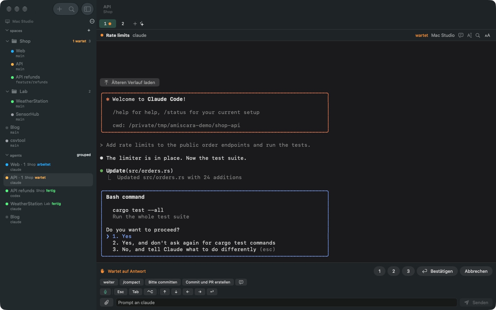
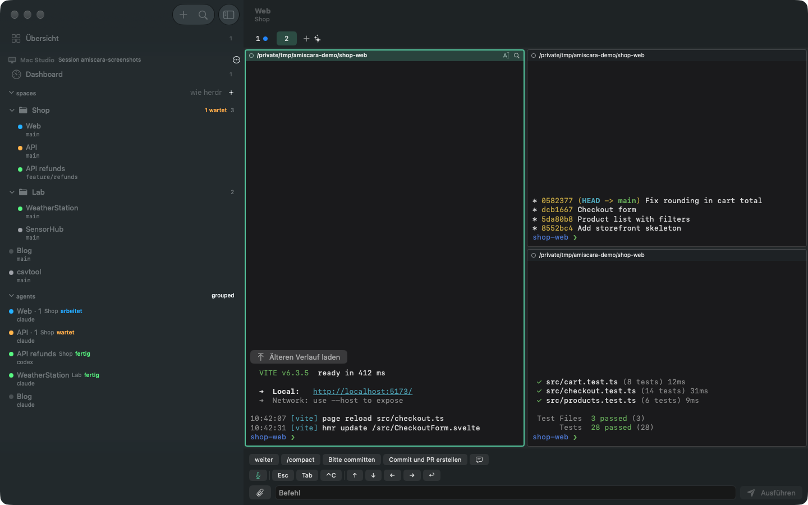
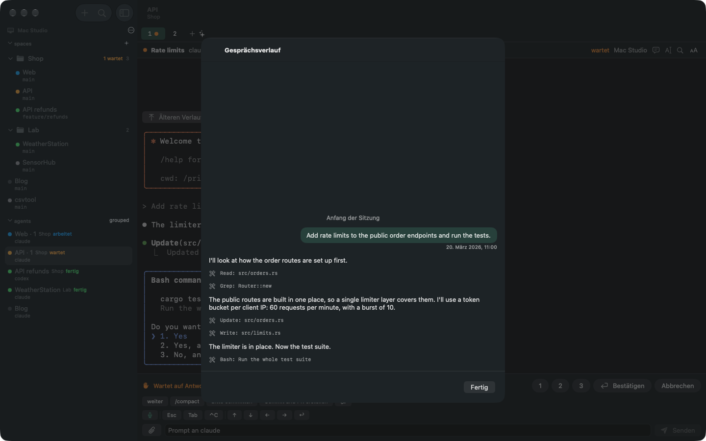
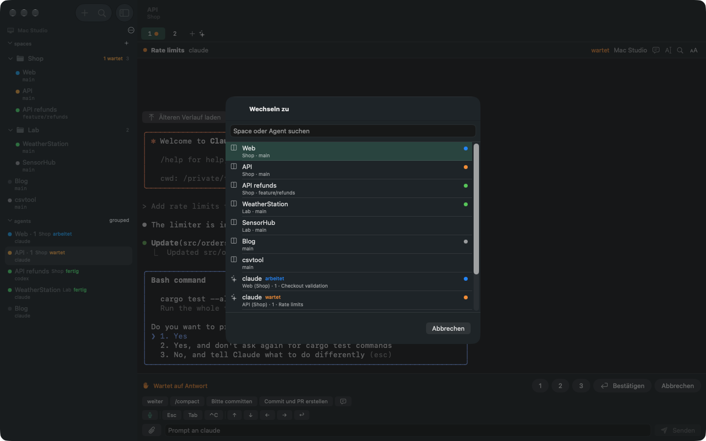
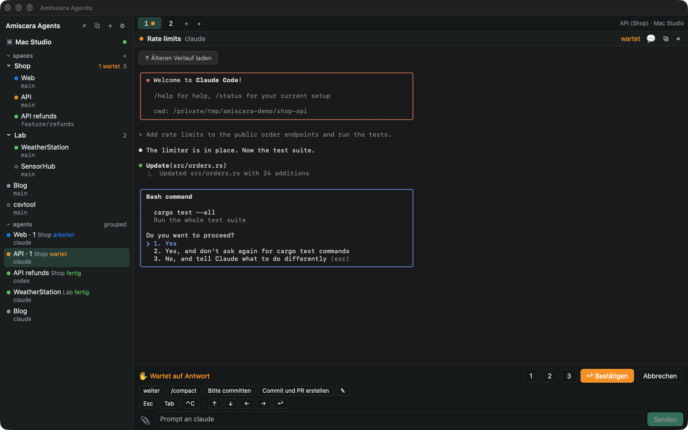
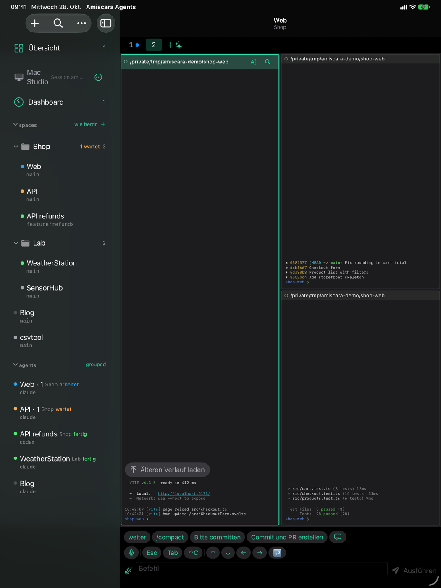
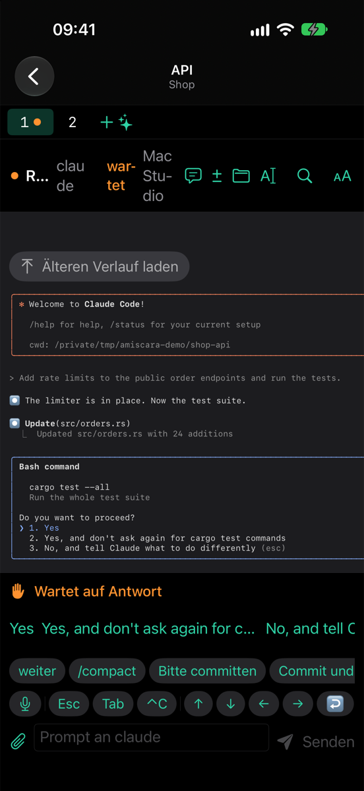
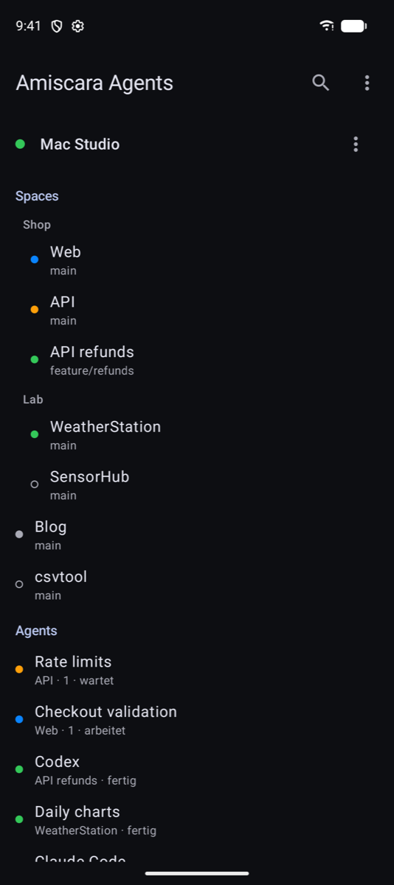
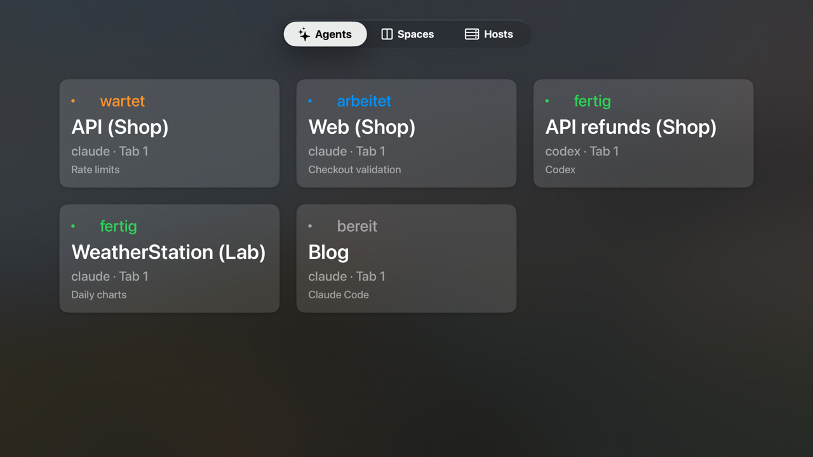

# Amiscara Agents

A graphical remote for [herdr](https://herdr.dev), the agent multiplexer for
the terminal, on Mac, iPad, iPhone, Apple Watch, Apple TV, Android, Windows
and Linux.

herdr runs coding agents such as Claude Code in terminal panes, grouped into
workspaces and tabs, and keeps them running when you close the terminal.
Amiscara Agents brings those agents to your other devices: which ones wait
for an answer, what they print, and the means to answer, prompt and manage
them from the couch, the phone or another computer.

The apps talk to an **unmodified herdr server**, locally over its Unix
socket or remotely over SSH. Nothing is installed on the server, and the SSH
key the apps use reaches the herdr socket and nothing else.

> Amiscara Agents is an unofficial project, not affiliated with herdr.
> The user interface is German and English, following the system language.

**Contents:**
[Screenshots](#screenshots) ·
[Platforms](#platforms) ·
[Features](#features) ·
[How it connects](#how-it-connects) ·
[Security model](#security-model) ·
[Install](#install) ·
[Setting up a host](#setting-up-a-host) ·
[Organizing spaces](#organizing-spaces-bereichname) ·
[Limits](#limits) ·
[Architecture](#architecture) ·
[Building from source](#building-from-source) ·
[Testing](#testing) ·
[Releases](#releases) ·
[Contributing](#contributing) ·
[License](#license)

## Screenshots

All screenshots come from a seeded demo session with fictional projects
(see [docs/screenshots.md](docs/screenshots.md)), shown here in German. More views per platform are in [docs/screenshots](docs/screenshots).

**Mac:** an agent waiting for approval, with the answer bar under the pane.



<table>
<tr>
<td width="50%"><br><sub>Mac: a split tab as herdr lays it out</sub></td>
<td width="50%"><br><sub>Mac: the Claude Code conversation of a pane</sub></td>
</tr>
<tr>
<td width="50%"><br><sub>Mac: quick switcher across all hosts</sub></td>
<td width="50%"><br><sub>Windows and Linux: the same views in the desktop app</sub></td>
</tr>
</table>

**iPad, iPhone and Android**

<table>
<tr>
<td width="50%"><br><sub>iPad: split tab</sub></td>
<td width="25%"><br><sub>iPhone: waiting agent</sub></td>
<td width="25%"><br><sub>Android: hosts, spaces, agents</sub></td>
</tr>
</table>

**Apple TV:** the agents of all hosts on the big screen.



## Platforms

| Platform | App | Minimum | Hosts | Notifications |
|---|---|---|---|---|
| Mac | SwiftUI, `apps/AmiscaraAgents` | macOS 27 | this Mac (socket) and SSH | local, plus menu bar |
| iPad, iPhone | SwiftUI, same sources | iOS 27 | SSH | push through iCloud from the Mac app |
| Apple TV | SwiftUI, same sources | tvOS 26 | SSH, home network only | none |
| Apple Watch | SwiftUI, `apps/AmiscaraAgents/Watch` | watchOS 26 | none: through the iPhone and iCloud | mirrored from the iPhone |
| Android | Kotlin, Jetpack Compose, `apps/android` | Android 10 | SSH | with answer buttons, while the app or its standby service runs |
| Windows | Tauri 2, `apps/desktop` | Windows 10, x64 or ARM64 | SSH | toasts, while in the tray |
| Linux | Tauri 2, `apps/desktop` | WebKitGTK 4.1 | this machine (socket) and SSH | libnotify, while in the tray |

All apps share the same host model, the same restricted `authorized_keys`
line and the same `amiscara-agents://add-host?v=1&...` link (shown as a QR
code), so a host is set up the same way everywhere.

## Features

### In every app

- **Hosts and agents at a glance:** all hosts with their connection state,
  their spaces (worktrees under their repository, `Bereich/Name` spaces
  grouped, see [below](#organizing-spaces-bereichname)), tabs and agents.
  Agents are sorted by urgency: waiting for an answer, working, done, idle.
- **Overview:** the agents of all hosts on one page, grouped into waiting,
  working and done, newest first, with the time in that state. Hosts
  without a connection show their last known state (or the Mac's board in
  iCloud) with its age. First entry of the sidebar on Mac, iPad and iPhone.
- **Live pane:** the selected pane's screen with colors, updated as it
  changes. Split tabs side by side as herdr lays them out, search with
  highlighted hits, font zoom, color schemes with a minimum contrast, web
  addresses in the output open in the browser, and older lines loaded in
  steps up to 1000 lines of scrollback. Optionally ("Vollbild-Agenten
  scrollen") page through a full-screen agent's own view and fetch its
  whole transcript; experimentally ("Zeilen umbrechen") wrap long lines at
  the window width instead of scrolling sideways.
- **Claude Code conversation:** for Claude panes the conversation itself
  (prompts, answers, tool calls), read from `~/.claude/projects` on the host
  over SFTP.
- **Input:** prompts to agents (`agent.prompt`), text to shells, a key bar
  (Esc, Tab, Ctrl-C, arrows, Enter) and quick replies. When an agent waits
  for approval, the input bar shows 1, 2, 3, Bestätigen and Abbrechen. A
  prompt starting with `/` goes live into the agent's own input line, so
  Claude Code shows its commands and skills in the pane (↑↓ pick, Tab takes,
  Enter runs).
- **Read-only switch per host**, for hosts you only want to watch.
- **Manage:** new space, tab (optionally starting an agent) and worktree;
  rename and close spaces and tabs; name an agent.
- **Uploads:** photos and files go to `~/.amiscara-agents/uploads/` on the
  host, their paths are appended to the prompt; agents such as Claude Code
  read images from there. Needs SFTP for the key, see
  [Uploads](#uploads-and-the-claude-conversation).
- **Files:** a read-only browser for the host's files, starting in the
  pane's working directory and limited to the home directory; text with
  search (the first MB), images, size and type of other files. Needs SFTP
  like uploads. Mac, iPhone and iPad.
- **Notifications** when an agent starts waiting or is done, with answer
  buttons, one per pane.
- **Pages agents open:** when an agent on the host opens a browser (a
  mockup, a sign-in), the apps on other devices offer the page; pages on
  the host's `localhost` load through the SSH connection. Needs the
  browser stand-in on the host, see
  [Setting up a host](#setting-up-a-host). Not on the Apple TV and Watch.
- **Handoff from other AI tools:** text planned in Claude, ChatGPT or
  elsewhere goes to an agent as a Markdown file in its composer, by share
  sheet, from the clipboard or as an `amiscara-agents://prompt` link, see
  [docs/ai-handoff.md](docs/ai-handoff.md). Mac, iPhone and iPad.
- **Quick switcher** (⌘K or Ctrl+K) across spaces and agents of all hosts,
  and keyboard shortcuts for spaces, tabs, search and the keys sent to the
  pane.

### Mac

- The local herdr server over its socket, plus any number of SSH hosts.
- Menu bar extra with the waiting agents of all hosts.
- Local notifications. The Mac app also writes one record per pane and
  state to the user's private iCloud database, which drives the push to
  iPhone and iPad and the boards on the Apple Watch (see below).
- Widgets, Siri and Shortcuts ("Welche Agents warten?", "Agent öffnen"),
  dictation, and the "Tasten" menu with shortcuts for the pane (⌘. Esc,
  ⇧⌘↩ Enter, ⌥⌘ arrows, ⌥⌘1 to 3 answers).
- Publishes its Bonjour name in iCloud so the Apple TV finds it.
- Distributed outside the App Store, signed with Developer ID and
  notarized; the App Sandbox would block the socket and SSH to arbitrary
  hosts (see [docs/release.md](docs/release.md)).

### iPad and iPhone

- Same sources as the Mac app; hosts over SSH only (iOS has no local
  socket). The app reconnects as soon as it returns to the foreground.
- **Push while the app is closed:** iPhone and iPad subscribe to the
  iCloud records of the Mac app, so Apple delivers a notification with
  answer buttons even when the app is not running. The devices find the
  host by the fingerprint of its SSH host key. Without a running Mac app on
  the host, iPhone and iPad notify only while the app runs.
- QR code scanner for adding hosts, camera and photo uploads, dictation,
  widgets, Siri and Shortcuts, hardware keyboard shortcuts on the iPad.

### Apple Watch

The Watch has no SSH (watchOS gives normal apps no sockets). It shows the
agents from the iPhone and from the boards the Mac app leaves in iCloud,
the screen excerpt of a waiting agent and answer keys. Answers go out
through the iPhone; when the iPhone is out of reach, they go through iCloud
to the Mac app on the host, if "Befehle über iCloud" is on there.
Complications show the number of waiting agents, also in the Smart Stack.

### Apple TV

- A tab bar with **Übersicht** (the overview as cards),
  **Spaces** and **Hosts**. Swipes on the Siri Remote scroll a focused
  pane, the back button returns. A reduced input bar sends keys and quick
  replies.
- **Top Shelf:** with the app in the top row of the home screen, the agents
  of all hosts appear there; selecting one opens its pane.
- **Pairing with the iPhone:** under Hosts › „Mit iPhone koppeln“ the TV
  shows a QR code with its own public key. Scanning it with the iPhone
  opens the app there; it adds a restricted line for the TV's key to
  `~/.ssh/authorized_keys` on the chosen hosts over SFTP (keeping the old
  file as `authorized_keys.bak-amiscara`) and leaves the host data for the
  TV in the private iCloud database. The TV's private key never leaves it.
  iPhone and TV need the same Apple ID.
- **Network:** the TV reaches hosts **only directly in the home network**
  (IP or Bonjour name). There is no NetBird, Tailscale or other VPN client
  for tvOS, so VPN-only names such as `mac.example.internal` or `100.x`
  addresses do not work. The Mac app on a host publishes its Bonjour name
  (`<LocalHostName>.local`) in iCloud under its SSH host key and the TV
  connects through it, still checking the pinned host key. For hosts
  without the Mac app (a Linux server, say) set an address the TV can reach
  in the host settings on the TV.
- Camera, clipboard, files, the app's own dictation, widgets,
  notifications and keyboard shortcuts do not exist on tvOS and are left
  out there.

### Android

- Phones and tablets; from 700 dp width (tablet, foldable, phone in
  landscape) the selected space shows next to the list.
- Hosts by hand, by QR code (CameraX and ZXing, no Google Play Services) or
  by link. Keys are generated by the Rust core and sealed with a key of the
  Android Keystore, excluded from cloud backup and device transfer.
- Notifications with answer buttons that also work while the app is
  closed; the optional **standby** (settings or Quick Settings tile) keeps
  the sessions in a foreground service so notifications keep coming. There
  is no push.
- Home screen widget with the waiting and working agents of all hosts.
- Hardware keyboard shortcuts like the desktop app.

Details: [apps/android/README.md](apps/android/README.md).

### Windows and Linux

- Hosts over SSH with a key of their own, kept in the OS key store
  (Windows Credential Manager, Secret Service on Linux), or through the SSH
  agent (Windows OpenSSH agent, `SSH_AUTH_SOCK` on Linux). On Linux also
  the local herdr socket.
- Closing the window keeps the app in the **tray** with its sessions, so
  notifications keep coming; it can start with the system, hidden in the
  tray.
- Updates itself from signed update files (see [Releases](#releases)).
- Ctrl where the Mac uses ⌘.

Details: [apps/desktop/README.md](apps/desktop/README.md).

## How it connects

herdr exposes a newline-delimited JSON API on `~/.config/herdr/herdr.sock`
(the protocol version is checked on `ping`, see
`herdr_proto::SUPPORTED_PROTOCOL`). The apps keep a live session per host: a
snapshot of all workspaces, tabs and panes, kept current by herdr's events,
and a follower per visible pane that reads its screen.

- **Locally** (Mac, Linux desktop) the core connects to the Unix socket.
- **Remotely** the core opens one SSH session to the host and one channel
  per request to that socket. SSH is implemented in Rust
  ([russh](https://github.com/Eugeny/russh)); no `ssh` binary is needed on
  the device.
- **Network:** anything that reaches the host's SSH port works: the local
  network, a VPN such as NetBird, Tailscale or WireGuard, or a port on the
  internet. The Apple TV is limited to the local network (see above).
- **Reconnect:** sessions reconnect with backoff after network changes or
  sleep; the mobile apps reconnect when they return to the foreground,
  after at least 30 s in the background also hosts that still look live
  (Android only without the standby), and the Mac app reconnects remote
  hosts after waking from sleep. The session keeps its state while it
  reconnects, so agents that changed in the meantime are reported.

### The restricted key line

Each device creates its own SSH key. It is locked down in
`~/.ssh/authorized_keys` on the host so that it reaches the herdr socket
and nothing else:

```
restrict,command="case \"$SSH_ORIGINAL_COMMAND\" in *sftp*) exit 1 ;; *) exec nc -U \"$HOME/.config/herdr/herdr.sock\" ;; esac" ssh-ed25519 AAAA... amiscara-agents
```

`restrict` turns off all forwarding (TCP and Unix sockets), the PTY and
agent forwarding; the forced command connects every session to the herdr
socket, whatever the client asks to run. Every app shows this line for its
key in the host editor, ready to copy. The desktop app can log in through
the SSH agent instead; that key then needs such a line too.

With "Lokale Webseiten weiterleiten" (Apple) or "Forward local web pages"
(desktop, Android) on, the line gets one more case before `*)`, so the app
can reach ports on the host's `localhost` for pages agents open there, and
nothing else:

```
amiscara-tcp*) p=${SSH_ORIGINAL_COMMAND#amiscara-tcp }; case $p in ''|*[!0-9]*) exit 1 ;; esac; nc -z localhost $p || { echo amiscara-tcp-closed; exit 1; }; echo amiscara-tcp; exec nc localhost $p ;;
```

Only digits reach `nc`. Without the case the app says that the host does
not forward `localhost` for this device; existing hosts need the new line
once. Each browser connection then takes one SSH session of the key, so
the app keeps at most five open at a time (sshd allows ten per connection
by default); a page with more waits for a free one. A forwarded port closes on the device after 30 minutes
without connections; the agent opens the page again when needed.

Older lines used `restrict,port-forwarding,command="/usr/bin/false"` and a
`direct-streamlocal` channel. They keep working (the app tries streamlocal
first and switches to the session when sshd refuses it), but
`port-forwarding` also allows TCP forwarding through the host, so a stolen
key could reach other machines from there; `permitopen` cannot narrow it,
it refuses streamlocal too (OpenSSH 10.3). Replace such lines with the one
the host editor shows now. `permitlisten="none"` is not accepted in
`authorized_keys` (sshd rejects the whole line).

### Uploads and the Claude conversation

Uploads, the Claude Code conversation, the Git changes and the file browser
need SFTP. Turn on the per-host switch "Bilder hochladen (SFTP)" (Apple) or
"Dateien hochladen (SFTP)" (desktop, Android) and use the key line with
`*sftp*) exec /usr/libexec/sftp-server ;;` instead of `*sftp*) exit 1 ;;`;
the host editor shows the right one. On Linux hosts the path of
`sftp-server` differs, e.g. `/usr/lib/openssh/sftp-server`.

**Be aware:** a key with SFTP can read and write every file of the user,
including `~/.ssh/authorized_keys`, so it is effectively full access to
that account. Leave SFTP off on keys that do not need it.

### Host keys

The first connection shows the host key's fingerprint; from then on it is
pinned for that host. A changed key stops the connection and has to be
trusted explicitly ("Neuen Schlüssel vertrauen"). A link or QR code scanned
in the app pins the host key it carries; a link opened from elsewhere does
not, and a link never replaces a key another host at the same address
already trusts.

## Security model

- **On the host:** nothing installed. Each device's key is restricted to the
  herdr socket by the line above; SFTP is opt-in per host and key.
- **On the device:** private keys stay in the platform's key store
  (Keychain on Apple devices, Android Keystore, Windows Credential Manager,
  Secret Service). The apps do not sync or back them up; the Apple TV's key
  never leaves the TV.
- **iCloud** (Apple devices only) holds the agent states the Mac app
  publishes, the TV pairing data and the Watch's commands, in the user's
  **private** database. No server of this project is involved.
- **Read-only hosts:** a per-host switch turns off all input.
- **herdr's API is powerful:** whoever reaches the socket can type into
  every pane, shells included. Treat each device key like a shell login to
  that user and remove its line from `authorized_keys` when a device is
  lost.

Report vulnerabilities privately, see [SECURITY.md](SECURITY.md).

## Install

| Platform | Where |
|---|---|
| Mac | signed and notarized build (`scripts/release.sh`), or build it yourself, below |
| iPad, iPhone, Apple TV, Apple Watch | TestFlight is being set up; until then build from source with `scripts/install-ios.sh` |
| Android | Google Play (testing track), or `scripts/install-android.sh` |
| Windows, Linux | installers (NSIS, MSI, AppImage, deb) from the [releases](https://github.com/staude/amiscara-agents/releases); the app updates itself (a `.deb` does not) |

Windows builds are not code signed yet: SmartScreen asks once per version.
A `.deb` does not update itself; install the new one by hand.

## Setting up a host

1. Install and start [herdr](https://herdr.dev) on the host. The apps use
   its default socket `~/.config/herdr/herdr.sock`.
2. Make sure SSH works: `sshd` running, `nc` installed (it connects the
   session to the socket; macOS ships it). Forwarding local web pages also
   needs `nc -z` (OpenBSD netcat, current ncat).
3. In the app add a host: name, address, port, user. The app creates a key
   and shows its `authorized_keys` line; append it to
   `~/.ssh/authorized_keys` of that user on the host.
4. Connect and confirm the host key fingerprint.
5. Optional, for pages agents open (#247): copy
   [`scripts/host/amiscara-open`](scripts/host/amiscara-open) to
   `~/.amiscara-agents/bin/` on the host, `chmod +x` it and make it the
   browser of the shells in herdr panes, in `~/.zshrc` or `~/.bashrc`:

   ```sh
   [ -n "$HERDR_PANE_ID" ] && export BROWSER="$HOME/.amiscara-agents/bin/amiscara-open"
   ```

   Agents such as Claude Code open links through `BROWSER`; the script
   still opens the page on the host and offers it to the connected apps
   for two minutes. Programs that call `open` or `xdg-open` directly are
   not covered, nor URLs over 1200 characters. A sign-in that returns to
   `localhost` from an outside page (e.g. `gh auth login`) only works on
   the host: just the page the agent opened is forwarded. For pages on the host's
   `localhost` turn on "Lokale Webseiten weiterleiten" for the host and
   replace its key line. The Mac app on the host itself ("Dieser Mac")
   does not ask: the page opens there already. On iPhone and iPad the page
   opens inside the app; Android hands it to the browser, and a forwarded
   page keeps loading only while Android keeps the app running in the
   background (reliably with "Bereitschaft" on).

To set up more devices, „QR-Code zeigen …“ in a host's menu (Apple apps)
shows an `amiscara-agents://add-host?...` link as QR code with address, user
and host key; scanning it on another device fills in the host and pins its
key. The new device still creates its own key and needs its own line.

## Organizing spaces: `Bereich/Name`

herdr has no folders above spaces. The apps group spaces by name instead:
everything before the first `/` is the group, the rest is the space's name.

```
Privat/Bürgertreff      → group "Privat":  Bürgertreff
Privat/Dorfkino         →                  Dorfkino
Arbeit/energieausweis   → group "Arbeit":  energieausweis
```

Each group is a foldable row with its number of spaces and waiting agents;
folding is remembered per device. Groups appear where their first space is
in herdr's order, spaces without `/` stay where they are. Spaces around the
`/` are ignored (`Privat / Dorfkino`), a name with an empty part
(`/Dorfkino`, `Privat/`) is not grouped. Linked worktrees stay under their
repository, even when their branch looks like `feature/x`. The name lives
on the server, so all devices show the same groups without any sync; herdr
itself simply shows the full name. Name a space this way when creating it
or via "Umbenennen …". The logic is in `crates/herdr-core/src/spaces.rs`.

The grouping is a per-host switch in the Apple apps: "Spaces nach Namen
gruppieren" in the host settings ("…" › "Bearbeiten …"), on by default.
Switched off, that host shows its spaces as herdr does, with full names in
herdr's order (linked worktrees still under their repository). The desktop
app reads the same setting (`groupSpaces` in `hosts.json`) but has no
switch for it yet.

## Limits

What the apps cannot do, because herdr's API does not offer it:

- **Pane size:** herdr sizes panes for the terminal attached on the host;
  without one, panes keep their last size (new ones 120×40). The apps show
  lines in that width and scroll sideways on narrow screens; the API has no
  way to set an absolute pane size. The experimental setting "Zeilen
  umbrechen" reads lines with herdr's soft wraps joined and wraps them at the
  window width; full-screen agents that wrap their own lines (Claude Code)
  are only clipped or wrapped a second time.
- **Scrollback of full-screen agents:** programs on the terminal's
  alternate screen, such as Claude Code, get no scrollback in herdr. For
  Claude the conversation view is the way to read back. The setting
  "Vollbild-Agenten scrollen" sends page keys to the agent and fetches its
  transcript through `agent.read` (idle agents only); both move the agent's
  view on the host too, so it is off by default.
- **Push without a Mac:** iPhone and iPad get pushes only through the Mac
  app's iCloud records. Android and the desktop app notify only while they
  run (Android's standby service keeps it running).
- **Apple TV:** home network only, no VPN.
- **Apple Watch:** no direct connection to hosts.

## Architecture

```
 SwiftUI (Mac, iOS, tvOS, watchOS)   Android (Compose)       Desktop (Tauri, Svelte)
        │ UniFFI: Swift                  │ UniFFI: Kotlin, JNA       │ Tauri commands
        └────────────── herdr-ffi ───────┘                           │
                              │                                      │
                              └──────────── herdr-session ───────────┘
                                                 │
                           herdr-core  (state, board, sync, panes, terminal)
                                                 │
                           herdr-transport  (Unix socket, SSH)
                                                 │
                           herdr-proto  (requests, responses, events)
```

- `crates/herdr-proto`: request, response and event types of herdr's
  socket API, protocol version check.
- `crates/herdr-transport`: local socket and SSH transport, requests and
  event subscriptions, host key checks.
- `crates/herdr-core`: session state from snapshot and events, the agent
  board, the sync driver with reconnect, pane content as styled lines (ANSI
  parsing, links), space grouping, the Claude conversation.
- `crates/herdr-session`: the live session the apps use: connect and
  reconnect, view records, pane followers, actions, uploads, Claude
  history, add-host links.
- `crates/herdr-ffi`: [UniFFI](https://mozilla.github.io/uniffi-rs/)
  bindings for Swift and Kotlin, a thin layer over `herdr-session`
  (`scripts/build-ffi.sh` builds the XCFramework and Swift code,
  `scripts/build-android-ffi.sh` the `.so` files and Kotlin code).
- `crates/uniffi-bindgen`: the binding generator, kept out of the app
  library.
- `crates/herdr-spike`: read-only command line probe (`ping`, `list`,
  `read`, `watch`, `board`, `check`, `view`, `bench`).
- `apps/AmiscaraAgents`: SwiftUI app for Mac, iPad, iPhone and Apple TV,
  plus the Watch app, widgets, complications and the Top Shelf extension.
  The Xcode project is generated by xcodegen from `project.yml`; platform
  differences are collected in `Platform.swift`.
- `apps/android`: Android app (Kotlin, Jetpack Compose, Gradle).
- `apps/desktop`: Tauri 2 app for Windows and Linux (Svelte, TypeScript;
  Rust crate `amiscara-desktop` in `src-tauri`).
- `scripts`: setup, checks, builds, installs and releases.
- `docs`: release setup, Play Store texts, third-party notices, icon
  sources, research notes.

Session logic belongs in `herdr-session`, so every app gets it; the FFI
layer and the desktop crate stay thin. The Rust crates keep their
`herdr-*` names because they describe the herdr protocol, not the app.

## Building from source

### Prerequisites

| For | Needs |
|---|---|
| everything | Rust stable (edition 2024) via [rustup](https://rustup.rs) |
| Apple apps | macOS with Xcode 27 (SDKs for macOS 27, iOS 27, tvOS 26, watchOS 26), [xcodegen](https://github.com/yonaskolb/XcodeGen) (`brew install xcodegen`) |
| Android | Android Studio (SDK, JDK 17), the NDK named in `apps/android/app/build.gradle.kts`, `cargo-ndk` |
| Desktop | Node 22 or newer; on Linux WebKitGTK 4.1 and friends (see [apps/desktop/README.md](apps/desktop/README.md#setup)) |

Then once:

```sh
./setup.sh   # checks the toolchain, builds and tests the workspace; on macOS also
             # the Swift bindings and the Xcode project, with an Android SDK the
             # Android Rust targets and cargo-ndk
```

On Linux without WebKitGTK, build the core with
`--exclude amiscara-desktop`.

### Core and probe

```sh
cargo build --workspace
cargo run -p herdr-spike -- ping
cargo run -p herdr-spike -- --ssh user@host --identity ~/.ssh/key bench
```

The spike only calls read-only methods. Pass `--accept-new-host-key` once to
record an unknown host key.

### Mac

```sh
xcodebuild -project apps/AmiscaraAgents/AmiscaraAgents.xcodeproj -scheme AmiscaraAgents \
    -derivedDataPath target/xcode build
open target/xcode/Build/Products/Debug/AmiscaraAgents.app
```

The aggregate target `HerdrFFI` runs `scripts/build-ffi.sh` before the app
targets, so Rust changes are picked up by every Xcode build. To build with
your own Apple developer team, change `DEVELOPMENT_TEAM` and the bundle,
app group and iCloud identifiers in `project.yml`; iCloud, push and app
groups need identifiers registered to your team.

### iPad, iPhone, Apple TV

Build, install and launch on a connected device with developer mode on:

```sh
scripts/install-ios.sh                # the only connected iPhone, iPad or Apple TV
scripts/install-ios.sh "iPad (2)"     # by name or UDID when several are connected
scripts/install-ios.sh --release      # Release build; --no-launch installs only
```

The Apple TV (scheme `AmiscaraAgents-tvOS`) must be paired with Xcode once
(Window › Devices and Simulators). `scripts/build-ffi.sh` builds the slice
the current Xcode platform needs and keeps the others in the framework.

### Android

```sh
scripts/install-android.sh      # builds, installs and launches on a phone or emulator
```

Gradle builds the Rust core itself before compiling. Details:
[apps/android/README.md](apps/android/README.md).

### Windows and Linux

```sh
cd apps/desktop
npm install
npx tauri dev       # window with hot reload (also works on the Mac)
npm run check       # svelte-check, TypeScript
npm run mock        # the window with sample data in a browser, no herdr needed
npx tauri build     # installers under target/release/bundle
```

## Testing

```sh
scripts/check.sh            # fmt, clippy, tests, npm run check
scripts/check.sh --apple    # also builds the Mac and iOS schemes
scripts/check.sh --android  # also builds the Android app with lint
```

CI (`.github/workflows/ci.yml`) runs the full chain for every pull request
and push to `main`: tests on Linux, macOS and Windows, the core for iOS and
tvOS, the Android app, the desktop app on all three systems. Started by hand
it also builds the installers as artifacts.

`scripts/screenshots.sh` takes the screenshots of all apps from a seeded
demo with fictional projects, see [docs/screenshots.md](docs/screenshots.md).

`scripts/ffi-smoke.sh` exercises the Swift bindings without the UI against
the local server; with `HERDR_SMOKE_SSH=user@host HERDR_SMOKE_KEY=<key>` it
also runs the SSH and host key flow.

**Test input only against a separate herdr session**, never the one with
real work:

```sh
herdr --session herdr-remote-test server &
HERDR_SMOKE_WRITE_SOCKET=~/.config/herdr/sessions/herdr-remote-test/herdr.sock \
    scripts/ffi-smoke.sh
herdr session stop herdr-remote-test
```

## Releases

- **Mac:** outside the App Store, signed with Developer ID and notarized:
  `scripts/bump-build.sh`, commit, `scripts/release.sh`. One-time setup
  (certificate, notarytool profile) in [docs/release.md](docs/release.md).
- **iPad, iPhone, Apple TV:** TestFlight is being set up; until then
  `scripts/install-ios.sh`.
- **Android:** Google Play. `scripts/android-upload-key.sh` once, then
  `scripts/android-release.sh <version>` per upload (signed App Bundle,
  higher `versionCode`, tag `android-v<version>`). Console texts, data
  safety and steps: [docs/play-store.md](docs/play-store.md).
- **Windows and Linux:** by tag. `scripts/desktop-release.sh <version>` sets
  the version and tags `desktop-v<version>`; the workflow
  `desktop-release.yml` builds the installers, signs the update files and
  publishes them to this repository's
  [releases](https://github.com/staude/amiscara-agents/releases), from which
  the app updates itself. See
  [apps/desktop/README.md](apps/desktop/README.md#deploy).

Changes are listed in [CHANGELOG.md](CHANGELOG.md). Third-party licenses
for binary releases: [docs/third-party-notices.md](docs/third-party-notices.md).

## Contributing

Issues and pull requests are welcome; see [CONTRIBUTING.md](CONTRIBUTING.md)
for setup, checks and conventions, and [CODE_OF_CONDUCT.md](CODE_OF_CONDUCT.md).

## License

Licensed under either of [Apache License 2.0](LICENSE-APACHE) or
[MIT](LICENSE-MIT), at your option. Unless you explicitly state otherwise,
any contribution you submit is dual licensed as above, without any
additional terms or conditions.
